# Cairn Project Guide

This guide explains what Cairn does, how route analysis works, and how to use the current interface.

## The project in one minute

Cairn is a browser-based Marswalk planning prototype. A user chooses a landing region, places waypoints on a 2D map, and asks the app to plan a path across terrain. The backend uses elevation data to estimate slope, searches for a slope-aware route, checks orbital image footprints along each route segment, and estimates mission resources from explicit crew assumptions. The user can stress-test a segment, inspect caveats, read field directions, and export a mission brief.

Cairn is decision support for a demonstration. It is not flight-certified, does not receive rover or astronaut telemetry, and cannot establish current local surface conditions.

## How the project works

```mermaid
flowchart LR
  U[User selects region and draws waypoints] --> F[React frontend: map, layers, tools]
  F -->|same-origin /api requests| A[FastAPI backend]
  A --> S[USGS / ODE data sources and local cache]
  S --> D[DEM elevation grid and image footprints]
  D --> R[Slope-aware A* route planning]
  R --> E[Per-segment evidence audit]
  E --> T[Stress tests and resource projection]
  T --> V[Plan verdict, dossier, Visor, mission brief]
  V --> F
```

### The calculation, step by step

1. **The user draws a route.** Each map click becomes a longitude/latitude waypoint. A route needs at least two points. The user can set the landing region, target name, and planned stops in **Tools**.
2. **The backend loads terrain and imagery coverage.** It requests a digital elevation model (DEM) and orbital product footprints for the bounding box around the waypoints. The backend caches successful upstream responses locally.
3. **The DEM becomes a grid.** Cairn derives slope values from neighboring elevation samples. The configured slope limit blocks cells that are too steep for the planner.
4. **A* finds the route.** The route planner searches eight neighboring cells at a time. Its travel cost increases with slope, and it can also produce an alternate path that avoids cells on the main path.
5. **The route is audited against three claims.** One calculation runs Terrain / bedrock, Current surface conditions, and Thermal context. Each segment is sampled against product footprints and checked for coverage, imagery scale, observation age, and whether the source is measured or illustrative. Claim cards let the user switch between these already-calculated results.
6. **Cairn stress-tests and estimates resources.** Stress tests simulate an unseen obstacle or added slope error. Resource estimates combine distance, slope, walking speed, load, stop time, and reserve assumptions to show best/worst estimates and a turn-back point.
7. **The results appear in several views.** The Plan view shows the map, verdict, evidence/resource strips, and segment dossier. Field visor presents directions for a selected segment. Mission brief formats route findings for printing or saving as PDF.

### Keep these verdicts distinct

| Display | What it means |
| --- | --- |
| **Supported / Check / Fragile** | How well the orbital evidence supports a segment for the selected claim. |
| **GO / GO WITH CHANGES / NO-GO** | A separate mission-level projection based on modeled resources, return reserves, daylight, and stress-test outcomes. |

A segment can be well supported by imagery while the overall mission projection is NO-GO, or have weak evidence while resource margins remain positive. The two verdict systems answer different questions.

### Data and limitations

| On screen | Role | Important limitation |
| --- | --- | --- |
| **Automatic · MDIM21** basemap | USGS WMS map image; Automatic currently selects MDIM21. | A basemap is visual context, not proof that an area is traversable. |
| **Slope / DEM** | Elevation data supplies the route grid, derived slope, and terrain visualization. | Regional MOLA data is coarse and may smooth local hazards. The 3D mesh visualizes the DEM; routing and audits use the DEM grid, not the rendered mesh. Fine 3D detail needs a separate HiRISE dataset and may not be installed in the hosted demo. |
| **CTX, HiRISE, CRISM, THEMIS footprints** | PDS orbital product footprints are queried through the ODE REST service and overlaid on the map. | A footprint means an observation covers an area; it does not mean the image resolves every hazard or describes present conditions. |
| **NASA rover image** | Optional image for visual context. | It is labeled as context imagery and is not necessarily from the route location. NASA's API key is only needed for NASA APOD and rover-photo requests, not route planning or the map. |
| **PLACEHOLDER DATA badge / illustrative footprint** | Lets the user see the interface when live product records are unavailable. | These polygons are synthetic examples, not orbital observations. Keep the badge and labels visible when presenting the project. |
| **Resource margins and assumptions** | A transparent projection using crew-defined inputs and a documented formula. | The public demo keeps assumptions read-only. Values are unvalidated and are not operational life-support telemetry. |

The Current surface conditions claim is deliberately cautious: orbital data is not live local weather or a current rover reading. THEMIS is regional thermal context, not astronaut-level surface temperature. The MEDA context source is not connected in this build.

## Current interface tour

- **Plan** is the main workspace. Its start guide explains how to create a route. The map style selector defaults to **Automatic · MDIM21**. The 2D / 3D control appears above the map; 3D requires a loaded DEM and browser WebGL support.
- **Tools** opens route setup, claim results, assumptions, advanced layers, sensor display modes, registry/context tools, and browser-local project save/load.
- **Guide** opens the built-in step-by-step demo.
- **Field visor** shows the selected segment's text directions and offers speech when browser speech synthesis is available.
- **Mission brief** formats the route findings, evidence caveats, resource margins, stress tests, sources, and next observation. Use **Print / Save PDF** to export it.
- **Clean** hides decorative map-console effects; it does not change the calculations.

On the Plan page, click an evidence strip segment or a waypoint/stop to open its dossier. Use **Show all flags and sources** for the complete evidence detail. After a route is calculated, **Run stress test** is available; the dossier also offers obstacle and slope-error scenarios.

## Example end-to-end walkthrough

1. Open the live demo at <https://cairn-xfny.onrender.com> and wait for the map and status to finish loading. Render's free service may need a short wake-up after idle time.
2. In **Tools**, leave the site on Jezero Crater and use a clear target name such as `South rim bedrock`.
3. Add two or three nearby points by clicking the map. The demo coordinates are approximately `77.57°E, 18.40°N`, `77.60°E, 18.40°N`, and optionally `77.62°E, 18.40°N`.
4. In **Tools**, choose **Calculate route + all 3 claims**. Review the route, mission margin, evidence/resource strips, and data-status labels.
5. Click a segment and inspect its dossier. If it has less than full HiRISE coverage, use it to understand the uncertainty and unseen-obstacle stress test.
6. Review whichever claim and mission verdict the app computes. Results depend on the data response, selected route, and assumptions; a particular GO / NO-GO result is not guaranteed.
7. Use **Field visor** for segment directions and **Mission brief** to review or print the route summary.

## Architecture for a technical explainer

| Part | Location | Responsibility |
| --- | --- | --- |
| React UI and map | `frontend/src/main.js` | Navigation, waypoints, layer controls, route requests, evidence panels, Visor and Brief views. |
| 2D / 3D display | `frontend/src/Map3DView.js`, `frontend/src/terrain.js` | Leaflet 2D map, Three.js terrain visualization, route/footprint overlays. |
| FastAPI routes | `backend/app/main.py` | Same-origin `/api` endpoints, route contexts, in-process rate limits, serving the built frontend. |
| Data adapters and cache | `backend/app/data_sources.py`, `backend/app/cache.py` | USGS basemaps and DEMs, ODE product footprints, local response caching, illustrative fallback footprints. |
| Route and audit logic | `backend/app/grid.py`, `backend/app/routing.py`, `backend/app/evidence.py` | DEM grid/slope derivation, A* path search, segment evidence checks. |
| Mission logic | `backend/app/stress.py`, `backend/app/resources.py`, `backend/app/params.py` | Scenario tests, resource/return projections, and the crew-assumption values. |

The public demo has no login; route state is kept in the single backend process and assumption updates are disabled. The frontend talks to the backend using same-origin `/api` requests. During development, Vite proxies those requests to FastAPI. In the Render deployment, the Docker build creates the frontend bundle and FastAPI serves it with the API. NASA keys remain server-side and are not required for the map, DEM, route, or evidence workflow.

Project inputs can be saved in the current browser with **Save project**. Loading restores those inputs, but the route must be recalculated. Route and dossier state lives in the backend process, so a service restart clears calculated results.
